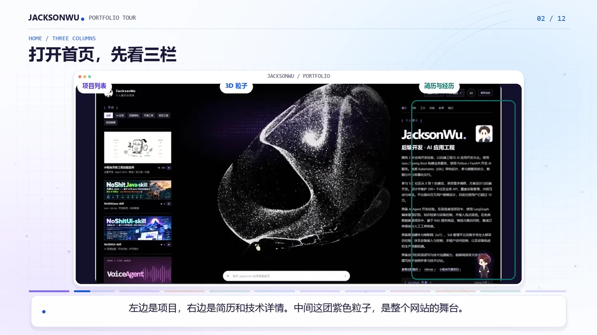
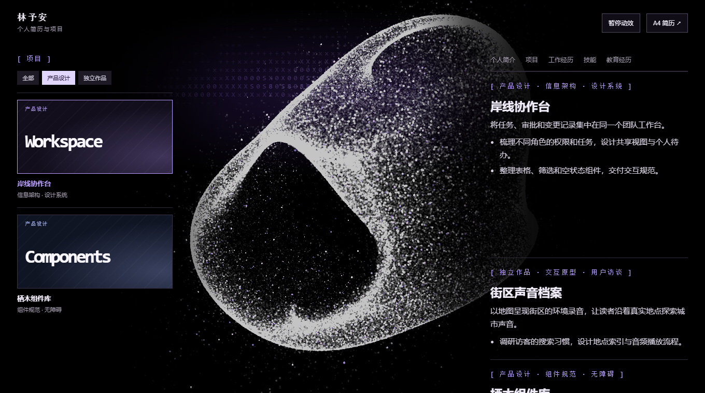
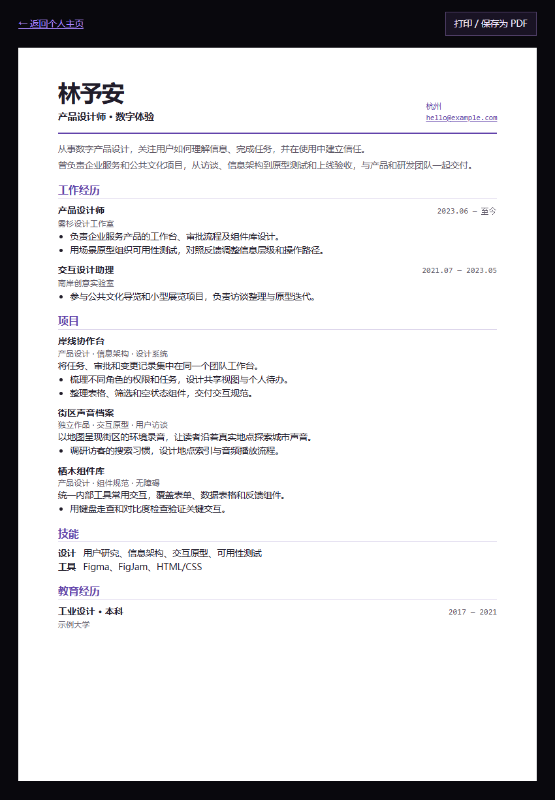
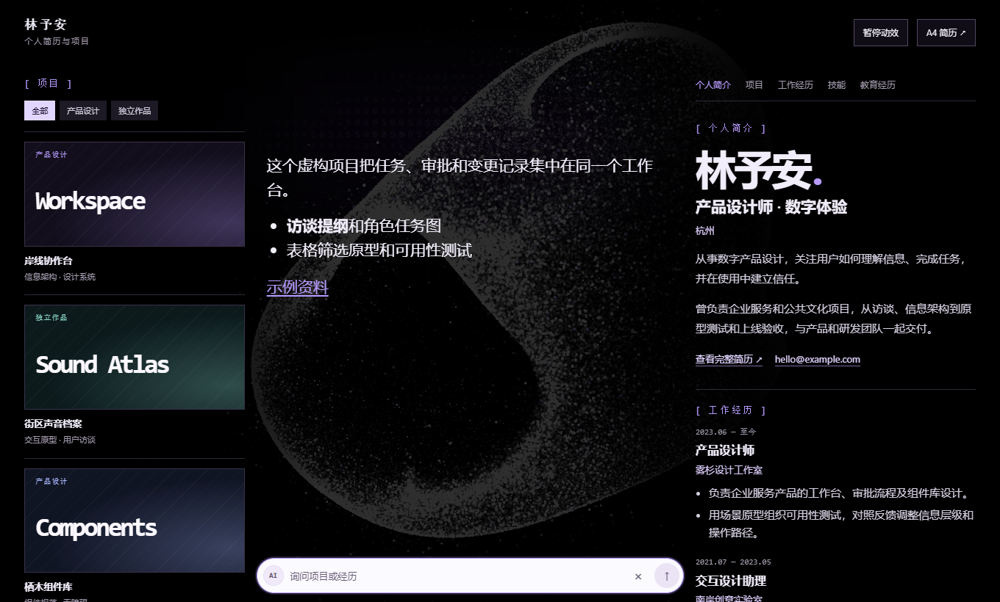

# Resume Portfolio

一套可自托管的个人作品集，包含静态简历网站、A4 打印简历和 AI 问答服务。网站保留项目卡片、交互式粒子背景、底部 AI 输入栏和中央回答区。AI 使用同仓库内的 Portfolio Agent 检索作品资料，通过 SSE 流式回答。

[](https://github.com/wzj1228516103/resume-portfolio/actions/workflows/checks.yml)

[打开演示](https://wzj1228516103.github.io/resume-portfolio/) · [预览 A4 简历](https://wzj1228516103.github.io/resume-portfolio/resume.html) · [使用此模板](https://github.com/wzj1228516103/resume-portfolio/generate) · [下载 Codex Skill](https://github.com/wzj1228516103/resume-portfolio/releases/latest)

## 🎬 观看原站导览

[](https://wzj1228516103.github.io/resume-portfolio/showcase/index.html)

[▶ 播放介绍视频](https://wzj1228516103.github.io/resume-portfolio/showcase/index.html) · **3 分 11 秒** · 中文配音和字幕

视频从原站的三栏布局出发，演示互动粒子、项目浏览、A4 简历、AI 追问和手机端。想用同一套框架做自己的作品集，可以从虚构示例开始。[试用开源模板](https://wzj1228516103.github.io/resume-portfolio/)

## 快速开始

**预览静态简历**。下载或复制仓库，双击 [`docs/index.html`](docs/index.html)。修改 [`docs/resume.js`](docs/resume.js) 后，首页和 A4 打印版会一起更新。

**本地运行网站和 AI**。需要 Node.js 22.19 或更新版本。在仓库根目录执行：

```sh
npm ci
cp agent/.env.example agent/.env
```

Windows PowerShell 用 `Copy-Item agent/.env.example agent/.env`。在 `agent/.env` 中填写自己的 `DEEPSEEK_API_KEY`，再从仓库根目录运行：

```sh
npm start
```

打开 [http://127.0.0.1:3000/](http://127.0.0.1:3000/)，试问「岸线协作台里，设计师负责什么？」本地启动器会为页面设置同源问答地址。要更换端口，设置 `agent/.env` 中的 `SITE_PORT`。

示例资料来自 [`agent/public-rag/example-profile.md`](agent/public-rag/example-profile.md)。可在 `agent/.env` 中用 `KNOWLEDGE_DIR` 指向自己的资料目录。Agent 会将检索到的片段随问题发送给配置的模型服务。[后端配置和 API 说明](agent/README.md)

## 页面预览


### 项目筛选和详情

按分类筛选项目，点击卡片跳到详细介绍。项目可附上封面、视频和外部链接。

[](https://wzj1228516103.github.io/resume-portfolio/#project-1)

| 手机浏览 | A4 打印版 |
| --- | --- |
| 简介排在最上方，项目卡片按两列展示。 | 用浏览器打印，或保存为 PDF。 |
|  | <a href="https://wzj1228516103.github.io/resume-portfolio/resume.html"></a> |

## 部署作品集

1. 点击 GitHub 页面上的 **Use this template**，创建自己的仓库。
2. 编辑 [`docs/resume.js`](docs/resume.js)，替换姓名、工作经历和项目。打开 `docs/index.html` 检查首页，再点右上角的 **A4 简历** 检查打印版。两页从同一份文件读取内容。
3. 在自己的仓库进入 **Settings → Pages**，选择 **Deploy from a branch**，分支为 `main`，目录为 `/docs`，然后保存。部署完成后，Pages 设置页会显示网站地址。

头像、封面和视频可以放到 `docs/assets/`，用 `./assets/文件名` 引用。通过 `lang` 切换中英文界面，空的项目或经历分区会自动隐藏。站点会公开你填入的资料，演示中的姓名和经历均为虚构。[简历字段说明](skill/README.md#简历字段)

## 从 PDF、Word 或文字生成

下载 [`resume-portfolio-skill.zip`](https://github.com/wzj1228516103/resume-portfolio/releases/latest/download/resume-portfolio-skill.zip)，把解压出的 `resume-portfolio` 目录放到自己的 `~/.codex/skills/`。上传简历文件或粘贴文字，在 Codex 中输入：

> `$resume-portfolio` 把这份简历做成个人网站，并保留可打印的 A4 版。

## 给线上网站接入 AI

GitHub Pages 发布 `docs/` 中的静态网站。对话栏默认显示服务尚未接入。要启用线上问答，把同仓库里的 Agent 部署在 Node.js 主机上，再为网站配置网关。



截图使用虚构资料和模拟网关响应。

1. 准备经过审阅的问答资料和来源清单，复制到 Node.js 主机。按 [Agent 部署说明](agent/README.md#接入公开作品集)启动服务和 HTTPS 网关。
2. 打开 [`docs/chat-config.js`](docs/chat-config.js)，把 `endpoint` 设为公开网关的 HTTPS 地址，例如 `https://api.example.com/chat/stream`。跨域部署时，网关需允许网站的 Origin。localhost 可使用 HTTP 测试。
3. 如果 Agent 开启了访客验证，同时填写同一网关的 `accessEndpoint`（例如 `/chat/access`）和你自己的 Turnstile **公开站点键** `turnstileSiteKey`。页面在发送提问前验证访客，短期访客令牌保存在当前页面内存中。

模型密钥、Agent 令牌和 Turnstile 验证密钥放在服务端的 `agent/.env` 或部署环境中。仓库中的配置示例保留空白字段，公开资料只放入你愿意展示给访客的内容。

回答完成后会显示最多三条追问建议。点击建议会在当前对话里继续提问。在 [`docs/resume.js`](docs/resume.js) 的简历对象中添加 `"followUpQuestions": ["你在这个项目里负责什么？"]` 可以替换通用建议，设为 `[]` 可以隐藏该区域。

### 从简历导出问答资料

```sh
npm run export:public
```

按编号选择项目、经历和技能，例如 `projects:1,experience:2,skills:1`。也可以用 `skills` 选择整个技能分区。逐项检查预览，确认后生成 `agent/public-rag/resume-profile.md`。导出只读取所选条目的标题和描述等正文，跳过独立的姓名、联系方式、链接和媒体字段。请一并检查正文里手动填写的个人信息。导出文件默认被 Git 忽略，部署时需要单独复制到服务器。

用 `npm run export:public -- --include projects:1,skills` 可以直接预览。非交互环境中，审阅后加 `--write` 才会写入。更新资料时可用 `--output updated-profile.md` 另存一份，审阅后在服务器上替换原来的文件。

[查看检索、终端和流式输出示例](agent/README.md#检索和流式输出)

## 源码与贡献

- [`docs/`](docs/) 是网站源码和 GitHub Pages 的发布目录。
- [`agent/`](agent/) 是问答后端、资料检索和本地启动器。根目录的 npm workspace 统一安装依赖。
- [`skill/`](skill/) 是 Skill 的指令与使用说明。运行 `python scripts/package-skill.py` 会把静态网站和 Skill 打成 `dist/resume-portfolio-skill.zip`。
- 运行 `npm run typecheck` 和 `npm test` 检查类型、公开资料导出、访客访问、配额和 Agent 的流式链路。运行 `npx playwright install chromium` 安装测试浏览器，再运行 `npm run test:browser` 验证首页、A4 简历、AI 问答及引用。模型调用使用模拟响应。GitHub Actions 在 PR 和 `main` 上运行这些测试、密钥扫描和 Skill 打包检查。

项目使用 [MIT 许可证](LICENSE)。随附的 [Three.js](docs/motion/three-LICENSE.txt) 和 [Marked](docs/marked-LICENSE.txt) 保留各自的 MIT 许可证。
