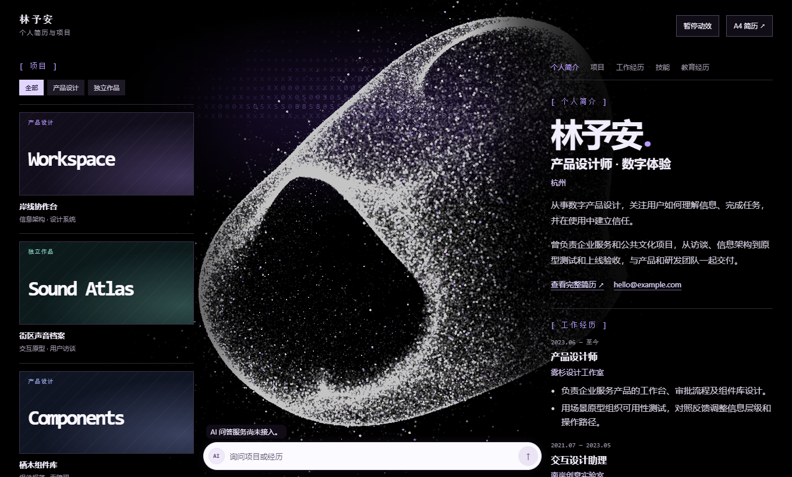
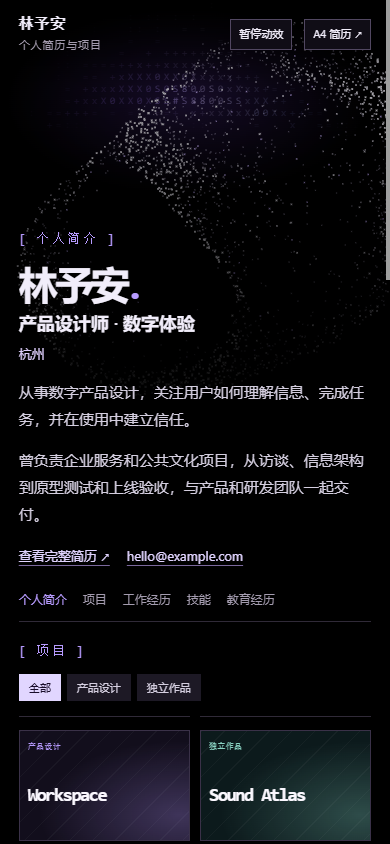

# Resume Portfolio

用一份简历数据生成个人作品集网站和可打印的 A4 简历。模板支持项目筛选、交互式粒子背景、移动端布局和 AI 问答预留，双击 `index.html` 就能预览。

[打开演示](https://wzj1228516103.github.io/resume-portfolio/) · [预览 A4 简历](https://wzj1228516103.github.io/resume-portfolio/resume.html) · [使用此模板](https://github.com/wzj1228516103/resume-portfolio/generate) · [下载 Codex Skill](https://github.com/wzj1228516103/resume-portfolio/releases/latest)

## 页面预览

### 项目筛选和详情

按分类筛选项目，点击卡片跳到详细介绍。项目可附上封面、视频和外部链接。

| 手机浏览 | A4 打印版 |
| --- | --- |
| 简介排在最上方，项目卡片按两列展示。 | 用浏览器打印，或保存为 PDF。 |
|  |  |

## 用自己的简历上线

1. 点击 GitHub 页面上的 **Use this template**，创建自己的仓库。
2. 编辑 [`docs/resume.js`](docs/resume.js)，替换姓名、工作经历和项目。打开 `docs/index.html` 检查首页，再点右上角的 **A4 简历** 检查打印版。两页从同一份文件读取内容。
3. 在自己的仓库进入 **Settings → Pages**，选择 **Deploy from a branch**，分支为 `main`，目录为 `/docs`，然后保存。部署完成后，Pages 设置页会显示网站地址。

头像、封面和视频可以放到 `docs/assets/`，用 `./assets/文件名` 引用。通过 `lang` 切换中英文界面，空的项目或经历分区会自动隐藏。站点会公开你填入的资料，演示中的姓名和经历均为虚构。[简历字段说明](skill/README.md#简历字段)

## 从 PDF、Word 或文字生成

下载 [`resume-portfolio-skill.zip`](https://github.com/wzj1228516103/resume-portfolio/releases/latest/download/resume-portfolio-skill.zip)，把解压出的 `resume-portfolio` 目录放到自己的 `~/.codex/skills/`。上传简历文件或粘贴文字，在 Codex 中输入：

> `$resume-portfolio` 把这份简历做成个人网站，并保留可打印的 A4 版。

## 接入 AI 问答

首页保留原站的浅色 AI 输入栏，流式回答在页面中央展开。示例的服务地址默认留空。

截图使用虚构资料和模拟网关响应。

1. 部署问答服务，并在服务端网关配置模型密钥和 Agent 令牌。[Portfolio Agent](https://github.com/wzj1228516103/portfolio-agent)
2. 打开 [`docs/chat-config.js`](docs/chat-config.js)，把 `endpoint` 设为公开网关的 HTTPS 地址，例如 `https://api.example.com/chat/stream`。跨域部署时，网关需允许网站的 Origin。localhost 可使用 HTTP 测试。
3. 如果 Agent 开启了访客验证，同时填写同一网关的 `accessEndpoint`（例如 `/chat/access`）和你自己的 Turnstile **公开站点键** `turnstileSiteKey`。页面在发送提问前验证访客，短期访客令牌保存在当前页面内存中。

问答请求包含 `message`、后续对话的 `sessionId`，以及启用验证时的 `accessToken`。页面用 `delta`、`done`、`error` SSE 事件更新回答，结束后渲染 Markdown。

## 源码与贡献

- [`docs/`](docs/) 是网站源码和 GitHub Pages 的发布目录。
- [`skill/`](skill/) 是 Skill 的指令与使用说明。运行 `python scripts/package-skill.py` 会把网站源码和 Skill 一起打成 `dist/resume-portfolio-skill.zip`。
- 欢迎提交 Issue 或 Pull Request。修正渲染或字段时，请一起检查首页和 A4 版。

项目使用 [MIT 许可证](LICENSE)。随附的 [Three.js](docs/motion/three-LICENSE.txt) 和 [Marked](docs/marked-LICENSE.txt) 保留各自的 MIT 许可证。
