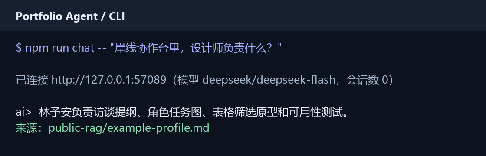
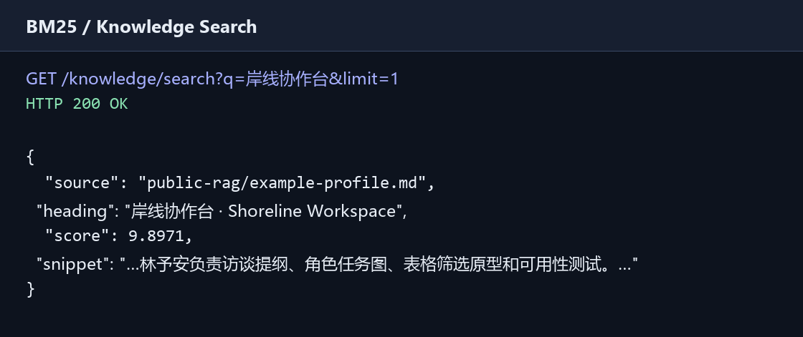
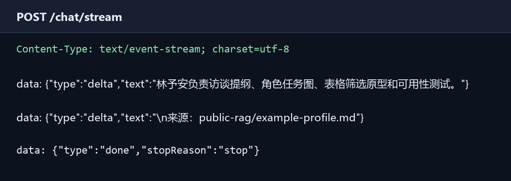
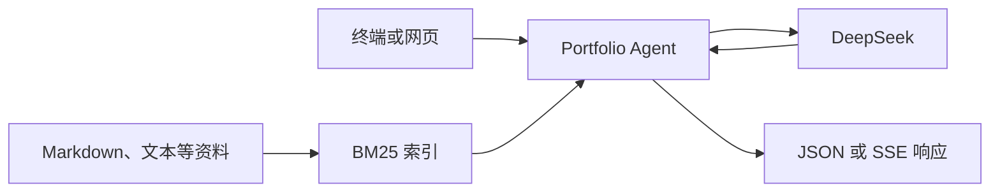

# Portfolio Agent 后端

一个可自托管的作品集与文档问答服务，使用 Pi Agent Core 和 DeepSeek，支持 BM25 检索、来源引用、多轮会话，以及 JSON 或 Server-Sent Events（SSE）响应。

[项目首页与网站启动](../README.md#快速开始) · [接口一览](#http-接口) · [接入作品集](#接入公开作品集)



演示取自本地服务的终端输出和 HTTP 响应，使用仓库里的[虚构作品集](public-rag/example-profile.md)和模拟模型响应。

## 本地运行

要单独运行 Agent 接口，在仓库根目录执行以下命令。需要 Node.js 22.19 或更新版本。

```sh
npm ci
cp agent/.env.example agent/.env
```

Windows PowerShell 用 `Copy-Item agent/.env.example agent/.env`。在 `agent/.env` 填写自己的 `DEEPSEEK_API_KEY`，然后运行 `npm run agent`。服务默认监听 `127.0.0.1:8787`。另开一个终端，运行 `npm run chat --workspace portfolio-agent` 开始多轮对话，或直接传入一个问题。

```sh
npm run chat --workspace portfolio-agent -- "岸线协作台里，设计师负责什么？"
```

可以通过 `KNOWLEDGE_DIR` 指向你自己的资料目录。相对路径以 `agent/` 为基准。检索支持 Markdown、文本、HTML 和 CSV。已检索的片段会随问题发给配置的模型服务。

## 检索和流式输出

**检索结果**显示命中片段的来源路径、标题和 BM25 分数。下图截取了示例查询的一条结果。



**流式回答**通过 `delta` 分段发送文本，通过 `done` 标记回答完成。下图截取了实际事件的主要字段。



## 请求流程



## HTTP 接口

| 方法与路径 | 用途 |
| --- | --- |
| `GET /health` | 检查服务状态 |
| `POST /chat` | 返回完整回答和会话 ID |
| `POST /chat/stream` | 以 SSE 发送增量、完成或错误事件 |
| `GET /sessions`、`GET /sessions/:id`、`DELETE /sessions/:id` | 查看或清除内存会话 |
| `GET /knowledge/status`、`GET /knowledge/search?q=...` | 查看索引或搜索 |
| `POST /knowledge/ingest` | 重新读取资料并构建索引 |

两个聊天接口均接收 `{"message":"问题","sessionId":"可选的已有会话 ID"}`。配置 `API_TOKEN` 后，受保护的请求需要 `Authorization: Bearer <token>`。非回环地址监听必须配置该令牌。

## 接入公开作品集

1. 设置 `PUBLIC_PORTFOLIO=1`、`PUBLIC_PORTFOLIO_ORIGIN` 和自己的 `API_TOKEN`。作品集来源应填写 HTTPS origin，例如 `https://portfolio.example`。服务保持监听 `127.0.0.1`。
2. 把允许对外回答的文档放在 `public-rag/`，并逐项加入 [公开资料白名单](src/knowledge/public-sources.ts)。公开模式只索引此目录下白名单中的文件，只开放健康检查和公开问答所需的接口。
3. 由 HTTPS 网关代网页转发问答。网关在服务端注入 `API_TOKEN`，覆盖 `X-Real-IP`，并为 SSE 禁用缓冲。网页连接网关的公开路径。
4. 如需访客验证，设置 `PUBLIC_ACCESS_REQUIRED=1`、`PUBLIC_TURNSTILE_SECRET`、独立的 `PUBLIC_ACCESS_SIGNING_KEY`（至少 32 字节）和 `PUBLIC_QUOTA_DB`（SQLite 数据库的绝对路径）。网关可转发 `POST /chat/access`，用 `challengeToken` 换取短期 `accessToken`，再在 `POST /chat/stream` 请求体中传入该令牌。

将模型密钥、网关令牌和访客签名密钥放进服务器的环境变量或密钥管理器。示例环境文件只提供键名，`.env`、本地语料和配额数据库默认被 Git 忽略。

## 开发

在仓库根目录运行 `npm run typecheck` 检查 TypeScript。`npm test` 离线验证公共访问、会话归属、SQLite 配额和本地网站的 SSE 问答链路。

[MIT 许可证](LICENSE)
