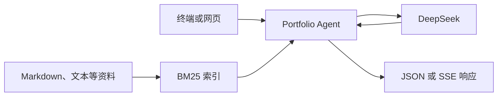

# Portfolio Agent 后端

一个可自托管的作品集与文档问答服务，使用 Pi Agent Core 和 DeepSeek，支持 BM25 检索、来源引用、多轮会话，以及 JSON 或 Server-Sent Events（SSE）响应。

[项目首页与网站启动](../README.md#快速开始) · [接口一览](#http-接口) · [接入作品集](#接入公开作品集)


演示取自本地服务的终端输出和 HTTP 响应，使用仓库里的[虚构作品集](public-rag/example-profile.md)和模拟模型响应。

## 本地运行

要单独运行 Agent 接口，在仓库根目录执行以下命令。需要 Node.js 22.19 或更新版本。

```sh
npm ci
cp agent/.env.example agent/.env
```

Windows PowerShell 用 `Copy-Item agent/.env.example agent/.env`。在 `agent/.env` 填写自己的 `DEEPSEEK_API_KEY`，然后运行 `npm run agent`。服务默认监听 `127.0.0.1:8787`。另开一个终端，运行 `npm run chat --workspace portfolio-agent` 开始多轮对话，或直接传入一个问题。

```sh
npm run chat --workspace portfolio-agent -- "岸线协作台里，设计师负责什么？"
```

可以通过 `KNOWLEDGE_DIR` 指向你自己的资料目录。相对路径以 `agent/` 为基准。检索支持 Markdown、文本、HTML 和 CSV。已检索的片段会随问题发给配置的模型服务。

## 检索和流式输出

**检索结果**显示命中片段的来源路径、标题和 BM25 分数。下图截取了示例查询的一条结果。


**流式回答**通过 `delta` 分段发送文本，通过 `done` 标记回答完成。下图截取了实际事件的主要字段。


## 请求流程



## HTTP 接口

| 方法与路径 | 用途 |
| --- | --- |
| `GET /health` | 检查服务状态 |
| `POST /chat` | 返回完整回答和会话 ID |
| `POST /chat/stream` | 以 SSE 发送增量、完成或错误事件 |
| `GET /sessions`、`GET /sessions/:id`、`DELETE /sessions/:id` | 查看或清除内存会话 |
| `GET /knowledge/status`、`GET /knowledge/search?q=...` | 查看索引或搜索 |
| `POST /knowledge/ingest` | 重新读取资料并构建索引 |

两个聊天接口均接收 `{"message":"问题","sessionId":"可选的已有会话 ID"}`。配置 `API_TOKEN` 后，受保护的请求需要 `Authorization: Bearer <token>`。非回环地址监听必须配置该令牌。

## 接入公开作品集

### 准备公开资料

在 Node.js 主机上创建专用资料目录，例如 `/srv/portfolio-knowledge`。将你审阅过的 Markdown 或其他纯文本文档复制或挂载到这个目录顶层。可以用根目录的 [导出命令](../README.md#从简历导出问答资料)生成初稿。自定义资料默认被 Git 忽略，每次新部署需要单独提供给服务。

在同一目录创建 `sources.json`，逐个列出允许 Agent 检索的文件。值可以是访客能打开的 HTTPS 网址，或用 `null` 将引用显示为文件名纯文本。

```json
{
  "resume-profile.md": "https://portfolio.example/",
  "public-faq.md": null
}
```

把示例中的条目替换成你实际部署的文件。公开模式启动时会检查白名单里的文件是否存在且可读取，未列出的文件不会被索引。调整资料或清单后重启 Agent。使用仓库内置虚构示例时，可以留空 `PUBLIC_KNOWLEDGE_DIR` 和 `PUBLIC_SOURCES_FILE`。

### 启动 Agent 和 HTTPS 网关

1. 从仓库根目录执行 `npm ci`，将 `agent/.env.example` 复制成 `agent/.env`。设置 `DEEPSEEK_API_KEY`、`API_TOKEN` 和下列公开模式变量。将作品集网址填写为 HTTPS origin，省略仓库子路径和结尾斜杠。

   ```dotenv
   PUBLIC_PORTFOLIO=1
   PUBLIC_PORTFOLIO_ORIGIN=https://portfolio.example
   PORTFOLIO_API_HOST=api.portfolio.example
   PUBLIC_KNOWLEDGE_DIR=/srv/portfolio-knowledge
   PUBLIC_SOURCES_FILE=/srv/portfolio-knowledge/sources.json
   ```

2. 在主机上运行 `npm run agent`，保持 Agent 监听 `127.0.0.1:8787`。安装 Caddy 并把 API 域名的 DNS 指向这台主机，用 [Caddyfile](deploy/Caddyfile) 启动网关。Caddy 和 Agent 读取同一份服务端环境配置。

   ```sh
   caddy run --config agent/deploy/Caddyfile --adapter caddyfile --envfile agent/.env
   ```

   此示例用于 Caddy 直接接收访客请求的部署。网关校验网页 Origin，只转发问答路径，注入服务端令牌并覆盖客户端 IP 头。SSE 响应即时转发。 [Caddy 反向代理文档](https://caddyserver.com/docs/caddyfile/directives/reverse_proxy)

3. 在 [`docs/chat-config.js`](../docs/chat-config.js) 填写 `https://api.portfolio.example/chat/stream` 后部署网站。用浏览器发送一个能从公开资料查到的问题，检查回答能否流式显示，引用能否打开。
4. 如需限制每位访客的频率，在服务端设置 `PUBLIC_ACCESS_REQUIRED=1`、`PUBLIC_TURNSTILE_SECRET`、独立的 `PUBLIC_ACCESS_SIGNING_KEY`（至少 32 字节）和 `PUBLIC_QUOTA_DB`（SQLite 数据库的绝对路径），再在前端配置 `accessEndpoint` 和 Turnstile 公开站点键。示例网关已配置 `/chat/access` 转发。

将模型密钥、网关令牌和访客签名密钥放进服务器的环境变量或密钥管理器。示例环境文件只提供键名，`.env`、本地语料和配额数据库默认被 Git 忽略。

## 开发

在仓库根目录运行 `npm run typecheck` 检查 TypeScript。`npm test` 离线验证公共访问、会话归属、SQLite 配额和本地网站的 SSE 问答链路。

[MIT 许可证](LICENSE)
